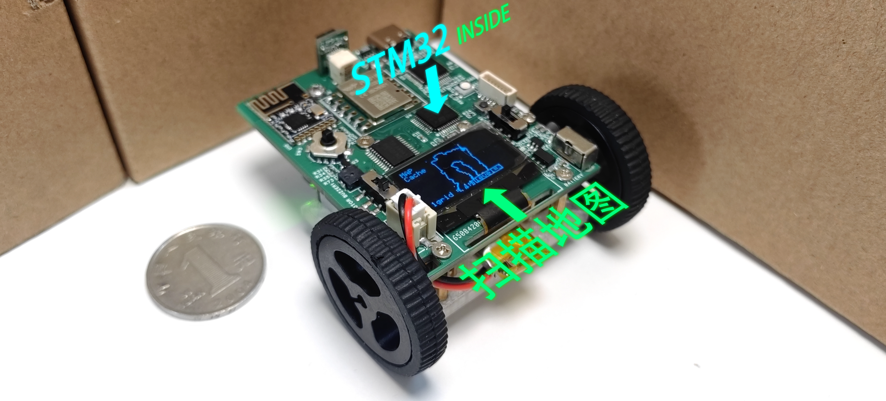
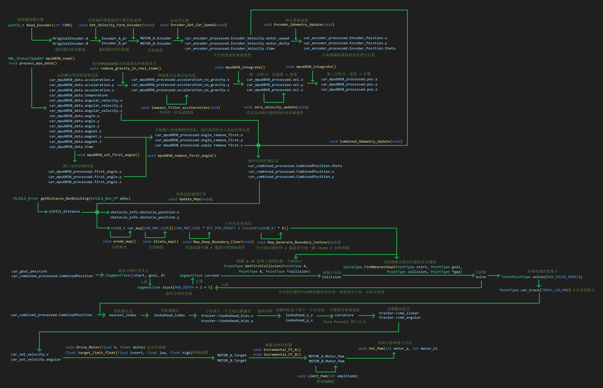

# STM32 建图导航小车
## 简介

这是我基于 STM32F103C8T6 开发的一款可自主建图与导航的微型智能小车。小车尺寸极为紧凑，仅 5×6 厘米，可轻松置于掌心。它配备有配套的遥控器。启动后，小车能够通过遥控器接收运动指令，同时利用自身搭载的编码器、MPU6050 和磁力计融合计算出准确的里程计信息，获得实时位姿。随后，结合车上的激光测距传感器探测障碍物位置，计算障碍物位置并逐步构建环境地图。当用户通过遥控器指定目标点后，小车的路径规划模块会计算出一条无碰撞的最优路径。接着，轨迹跟踪模块通过运动学逆解，将路径指令分解为左右轮的目标速度，最终通过PI速度环驱动电机，使小车自主、平稳地驶向目标点。 

在这几年中，我为了比赛，和队友一起先后搭了好多辆小车，可是由于每次都是临时搭建，准备时间少，基础不牢，往往小车功能都十分简陋，只能巡线避障或完成题目的业务逻辑，好多场比赛也失利了。但是在这期间我被ROS小车的导航和建图吸引了，大二的暑假我开始捣鼓ROS小车。在分析轮趣的ROS小车工程的时候，我被深深的震撼了，这个小车的功能不是完成比赛的特定要求，而是能够在一个不确定的现实生活中，通过建图和导航等手段，准确地前往目标点，这才是小车在现实生活中最实用的功能！可是，当我想了解建图和导航算法的时候，我发现在ROS小车中，编写者为了简便开发，直接调用了ROS的成品节点来实现，导致我只能看到一个黑盒子，却不知道里面是怎么实现的。刚好我想做一个尽可能小的迷你小车，这样可以随处把玩。由于受到尺寸的限制，只能使用MCU。由于这是我的支线项目，我不打算花太多时间，于是我想只用MCU来实现简易的建图和导航算法，集成到这个迷你小车里面，于是这个小车就诞生了。 

代码结构如下图所示：

## 演示视频
https://www.bilibili.com/video/BV1NVXhB8ECp

## 注意事项
1.车子和遥控器的蜂鸣器电路中的三极管误用PNP，应该改为NPN三极管 

## 参考资料
1.stm32硬件设计 https://oshwhub.com/gbn2333/stm32f103-KFB 
2.VL53L1硬件设计 https://oshwhub.com/ld_xk/vl53l 
3.轮趣科技ROS教育机器人 电机控制、编码器控制、运动学正解、运动学逆解相关代码 https://www.wheeltec.net/product/html/?170.html 
4.江协科技OLED驱动 https://jiangxiekeji.com/download.html 
5.NRF24L01驱动 来源于网络，具体来源信息已丢失 
5.vl53l1x驱动 https://github.com/wmdscjhdpy/VL53L1X_STM32_module 

## 相关非标准元器件参考
1.蜗轮蜗杆1218-N20直流编码器减速电机 3V6V12V微型齿轮低转速电机 3V95转/分钟;单轴;不带固定座 https://item.taobao.com/item.htm?id=692015663787 
2.miniQ小车 34MM 模型车轮胎 D孔3毫米 N20减速电机搭配轮 黑色 https://item.taobao.com/item.htm?id=609636631126 
3.迷你牛眼万向球 3PI小车优质N20万向轮 迷你小车 乐高万向轮 https://item.taobao.com/item.htm?id=578126886442 
4.JY901S串口9轴加速度计MPU6050陀螺仪卡尔曼滤波姿态角度输出模块 https://item.taobao.com/item.htm?id=44267507302 
5.NRF24L01+贴片迷你版 无线收发模块 功率加强版2.4G接收发射通信 https://item.taobao.com/item.htm?id=646120017146 